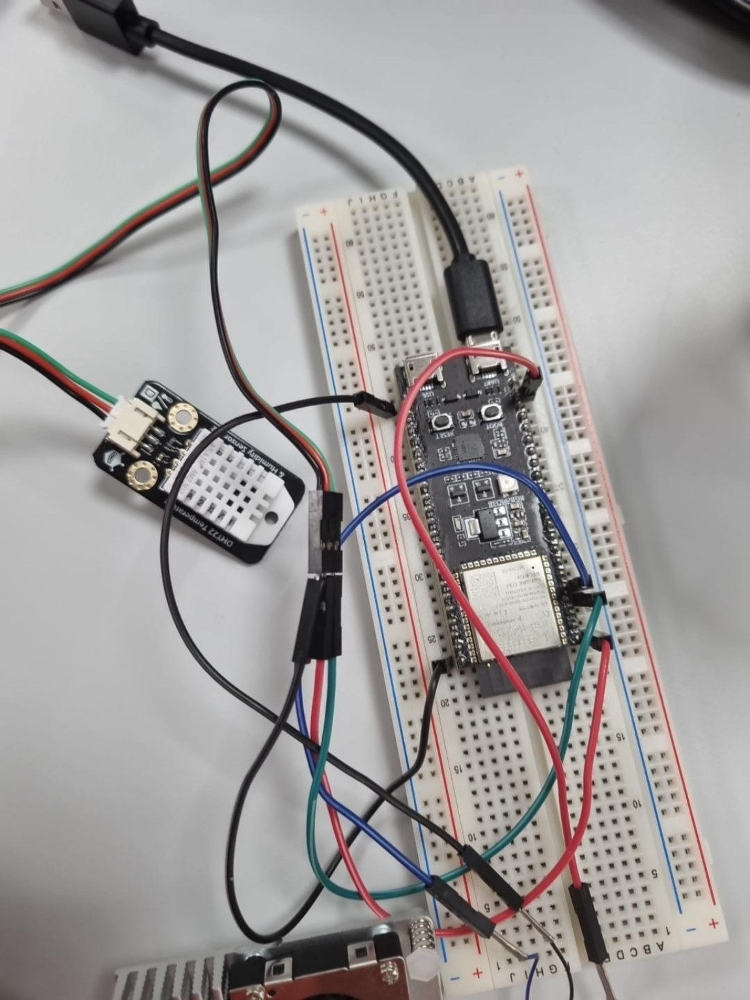
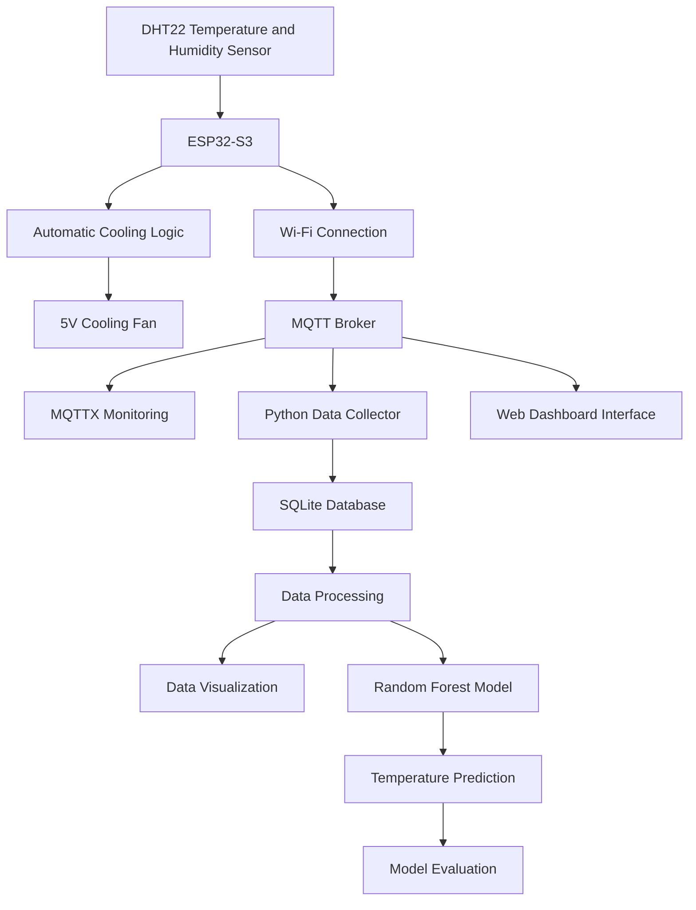
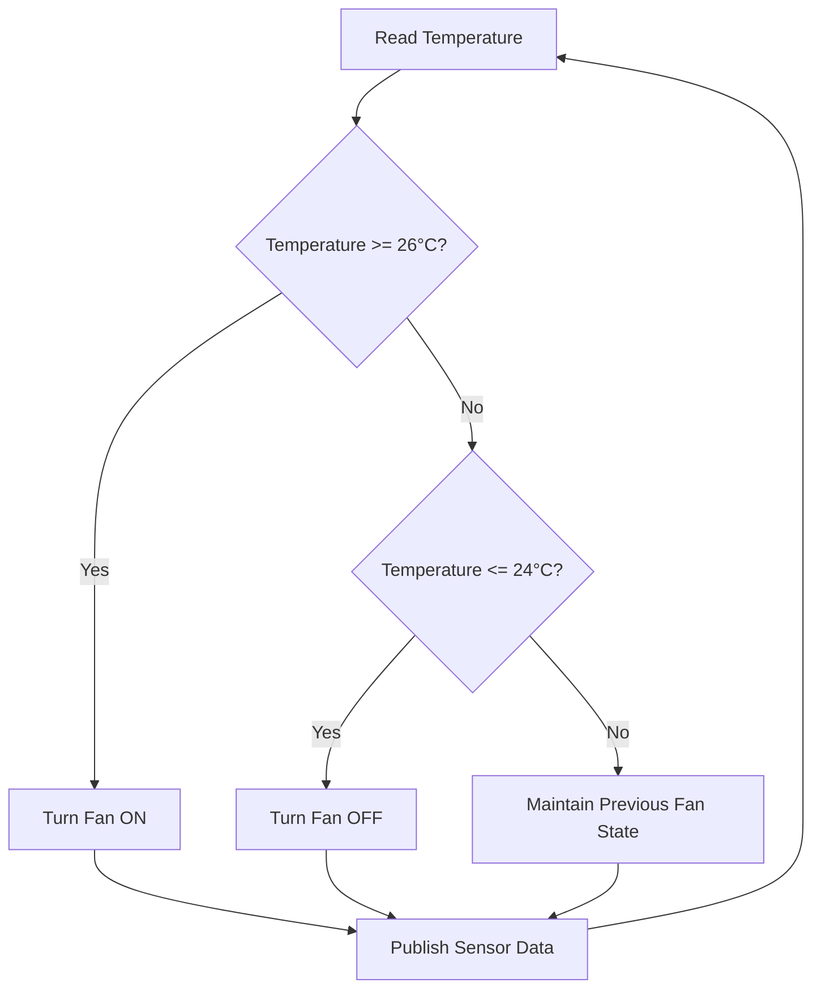
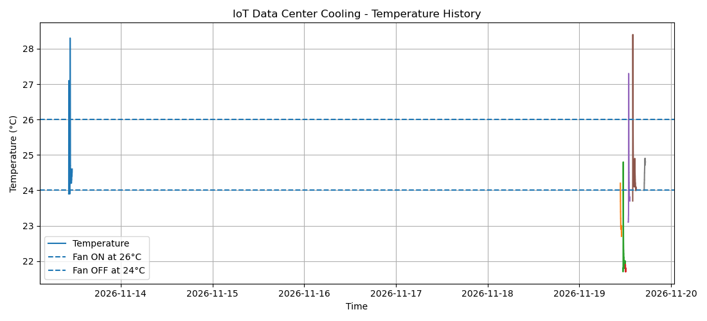
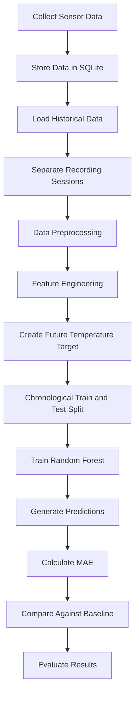
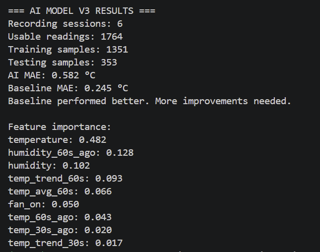

# IoT-Based Data Center Cooling System

## 1. Project Overview

This project was developed as part of the Internet of Things Engineering degree at Savonia University of Applied Sciences, Finland.

The main objective is to develop an IoT-based cooling prototype that monitors environmental conditions, automatically controls a cooling fan, collects historical sensor data, and explores the use of Artificial Intelligence for temperature prediction.

The project combines several engineering fields:

- Embedded Systems
- Internet of Things (IoT)
- Wireless Communication
- MQTT Protocol
- Python Programming
- Database Management
- Data Engineering
- Data Visualization
- Artificial Intelligence and Machine Learning

## 2. Project Team

- **Hossam Ragab** – Team Leader, Embedded Systems, Data Collection and Machine Learning
- **Md Mohiuddin Mollah** – Web Dashboard Development

**University:** Savonia University of Applied Sciences

**Degree Programme:** Internet of Things Engineering

**Year:** 2026

---

## 3. Background and Problem Statement

Data centers contain servers and networking equipment that generate heat during operation. High temperatures can negatively affect equipment performance, reliability, energy consumption, and hardware lifetime.

Traditional cooling systems often operate based on fixed temperature thresholds. Although this approach is effective, it reacts to temperature changes rather than predicting them.

This project explores two approaches:

1. Reactive cooling using automatic temperature thresholds.
2. Predictive temperature monitoring using machine learning.

The long-term idea is to investigate whether historical sensor data can help predict temperature increases before they happen and support more efficient cooling decisions.

This project is a small-scale proof of concept rather than a production-ready data center cooling solution.

## 4. Project Objectives

- Monitor temperature and humidity in real time.
- Automatically activate and deactivate a cooling fan.
- Prevent unnecessary fan switching using hysteresis.
- Publish sensor readings through MQTT.
- Collect and store historical sensor data.
- Visualize temperature changes over time.
- Develop and evaluate machine learning models.
- Predict temperature approximately five minutes ahead.
- Compare AI predictions against a simple baseline.
- Investigate the potential of predictive cooling.

---

## 5. Hardware Components

| Component | Purpose |
|---|---|
| ESP32-S3 | Main microcontroller and wireless communication |
| DHT22 (AM2302) | Temperature and humidity measurement |
| 5V Cooling Fan | Cooling and airflow |
| Breadboard | Hardware connections |
| Jumper Wires | Electrical connections |
| USB-C Cable | Power supply and programming |
| Computer | Development, monitoring and AI experiments |

### Hardware Prototype



### ESP32-S3

The ESP32-S3 is the main controller of the system. It reads environmental data from the DHT22 sensor, controls the cooling fan, connects to Wi-Fi, and publishes data through MQTT.

### DHT22 Sensor

The DHT22 measures:

- Temperature in degrees Celsius.
- Relative humidity as a percentage.

The measurements are used for real-time monitoring, automatic cooling control, historical analysis, and machine learning.

### Cooling Fan

The 5V fan represents the cooling equipment in a small-scale data center environment.

The fan is automatically controlled according to the measured temperature.

## 6. Hardware Connections

### DHT22 Connections

| DHT22 Pin | ESP32 Connection |
|---|---|
| VCC | 5V |
| GND | GND |
| DATA | GPIO 4 |

### Cooling Fan Connections

| Fan Wire | Connection |
|---|---|
| Red | 5V power supply |
| Black | GND |
| Blue | GPIO 5 – PWM control |
| Yellow | Tachometer – not connected |

The prototype uses the fan control input to control cooling operation.

The fan's electrical compatibility and power requirements should be verified before applying this design to other hardware.

---

## 7. System Architecture

The system consists of four main layers:

### Hardware Layer

The ESP32-S3, DHT22 sensor, and cooling fan are responsible for environmental monitoring and physical cooling.

### Communication Layer

The ESP32 connects to Wi-Fi and publishes temperature, humidity, and fan status to an MQTT broker.

### Data Layer

A Python application subscribes to MQTT topics and stores the received sensor readings in an SQLite database.

### Artificial Intelligence Layer

Historical sensor data is processed and used to train and evaluate machine learning models.

### System Architecture Diagram



The AI component operates independently from the automatic fan controller. AI predictions are not currently used to control the fan.

---

## 8. Automatic Cooling Control

The cooling system uses temperature thresholds and hysteresis to control the fan.

| Temperature | Fan Behaviour |
|---|---|
| 26°C or higher | Fan turns ON |
| 24°C or lower | Fan turns OFF |
| Between 24°C and 26°C | Fan maintains its previous state |

### Why Hysteresis?

Without hysteresis, the fan could repeatedly switch ON and OFF when the temperature fluctuates around a single threshold.

Using two different thresholds reduces unnecessary switching and improves operational stability.

### Cooling Logic



The automatic cooling system does not require a machine learning model to operate.

---

## 9. MQTT Communication

MQTT is a lightweight messaging protocol commonly used in IoT applications.

It allows connected devices to exchange information through a publish-subscribe architecture.

In this project, the ESP32 acts as an MQTT publisher, while MQTTX, the Python data collector, and compatible dashboard applications can act as subscribers.

### MQTT Broker Configuration

| Parameter | Value |
|---|---|
| Broker | broker.emqx.io |
| MQTT Port | 1883 |
| WebSocket Port | 8084 |
| WebSocket Protocol | WSS |
| WebSocket Path | /mqtt |

### MQTT Topics

| Topic | Description |
|---|---|
| hossam7192/datacenter/temperature | Current temperature |
| hossam7192/datacenter/humidity | Current humidity |
| hossam7192/datacenter/fan/status | Current fan status |

### Example MQTT Messages

Temperature:

```
26.4
```

Humidity:

```
42.5
```

Fan status:

```
ON
```

These messages are examples of the data format used by the system.

### MQTTX

MQTTX was used during development to subscribe to MQTT topics and verify that the ESP32 was successfully publishing sensor readings.

This helped test the communication between the embedded system and external applications.

### Security Considerations

The project uses a public MQTT broker for educational and prototyping purposes.

A production implementation should use:

- A private MQTT broker.
- Authentication and authorization.
- Encrypted communication.
- Secure credential management.
- Restricted access to sensor data.

---

## 10. Web Dashboard

A web dashboard interface was included in the project architecture to support remote monitoring.

The intended dashboard functionality includes:

- Displaying the current temperature.
- Displaying the current humidity.
- Displaying the fan status.
- Receiving real-time updates through MQTT over WebSockets.

The dashboard can subscribe to the same MQTT topics used by the Python data collector.

The dashboard development is separate from the embedded controller and machine learning components.

---

## 11. Historical Data Collection

A Python application was developed to collect real sensor data from the MQTT broker.

The application subscribes to the temperature, humidity, and fan status topics and stores the received information in a local SQLite database.

### Technologies Used

- Python
- Paho MQTT
- SQLite
- MQTT

### Collected Data

The stored information includes:

| Data | Description |
|---|---|
| Timestamp | Time of the recorded measurement |
| Temperature | Measured temperature in Celsius |
| Humidity | Relative humidity |
| Fan Status | ON or OFF |

Approximately 3,000 raw sensor readings were collected during the project.

The number of usable samples for machine learning is lower because historical features and future target values must be available within the recording sessions.

### Why SQLite?

SQLite was selected because it is:

- Lightweight.
- Easy to integrate with Python.
- Suitable for small IoT prototypes.
- Available without a separate database server.
- Useful for local historical data analysis.

The database is stored locally and is excluded from Git version control.

---

## 12. Data Visualization and Analysis

Python and Matplotlib were used to visualize historical sensor measurements.

The visualization helps identify:

- Temperature increases and decreases.
- Cooling behaviour.
- Temperature threshold crossings.
- Different recording sessions.
- Environmental changes over time.

### Historical Temperature Graph



### Recording Sessions

Data was collected during multiple recording sessions rather than continuously throughout the project.

Initially, the visualization connected measurements from different sessions, creating misleading lines across periods when no data was recorded.

The visualization was improved by separating recording sessions when the time gap between measurements exceeded 10 seconds.

This made the graph more representative of the actual recorded measurements.

### Observed Temperature Range

During an earlier data collection snapshot, the recorded temperature ranged from approximately:

- Minimum temperature: 21.7°C
- Maximum temperature: 28.4°C

The collected data included periods of heating, cooling, and different fan operating states.

---

## 13. Artificial Intelligence Component

The AI component investigates whether machine learning can predict future temperature using historical IoT sensor data.

### Machine Learning Objective

Predict the temperature approximately five minutes into the future.

Instead of only reacting when the temperature reaches a threshold, a predictive model could potentially identify an upcoming temperature increase.

For example, a future cooling system could use reliable temperature predictions to activate cooling before the temperature reaches a critical level.

However, this functionality has not been implemented in the current automatic cooling controller.

### Machine Learning Algorithm

The project uses Random Forest Regression.

Random Forest is a supervised machine learning algorithm that combines multiple decision trees to produce a numerical prediction.

It was selected because it:

- Can learn nonlinear relationships.
- Supports multiple input features.
- Provides feature importance information.
- Is suitable for structured sensor data.
- Can be implemented using Scikit-learn.

### AI Development Workflow



---

## 14. Feature Engineering

Feature engineering is the process of creating useful input variables from raw data to help a machine learning model understand patterns.

The final model uses nine input features.

| Feature | Description |
|---|---|
| temperature | Current temperature |
| humidity | Current humidity |
| fan_on | Current fan status represented numerically |
| temp_30s_ago | Temperature approximately 30 seconds earlier |
| temp_60s_ago | Temperature approximately 60 seconds earlier |
| humidity_60s_ago | Humidity approximately 60 seconds earlier |
| temp_trend_30s | Recent temperature change over 30 seconds |
| temp_trend_60s | Recent temperature change over 60 seconds |
| temp_avg_60s | Average temperature over the previous 60 seconds |

Historical features allow the model to investigate whether the temperature is increasing, decreasing, or remaining stable.

The prediction target is the measured temperature approximately five minutes after the current reading.

The final model accepts future measurements within a time window of approximately 270–330 seconds.

---

## 15. Baseline Model

A baseline is a simple prediction method used to evaluate whether a more complex machine learning model provides additional value.

The baseline used in this project assumes that the future temperature will remain equal to the current temperature.

For example:

```
Current temperature: 25.0°C
Predicted temperature after 5 minutes: 25.0°C
Actual temperature after 5 minutes: 25.3°C
Absolute prediction error: 0.3°C
```

Although the baseline is simple, it can perform well when environmental temperatures change slowly.

A machine learning model should ideally outperform this baseline before being considered useful for predictive cooling.

---

## 16. Machine Learning Experiments

Three versions of the machine learning model were developed and evaluated during the project.

### Version 1 – Initial Experiment

The first version established the basic machine learning workflow.

The objective was to determine whether historical sensor data could be used to train a temperature prediction model.

| Metric | Result |
|---|---|
| AI MAE | 1.335°C |
| Baseline MAE | 0.538°C |

The baseline performed better than the AI model.

This experiment demonstrated the need for further investigation of data preparation and model inputs.

### Version 2 – Second Experiment

The second version continued the investigation of temperature prediction and model performance.

| Metric | Result |
|---|---|
| AI MAE | 1.629°C |
| Baseline MAE | 0.495°C |

The AI model did not outperform the baseline.

This experiment demonstrated that modifying a machine learning model does not necessarily improve its performance.

### Version 3 – Improved Experimental Pipeline

The third version introduced a more structured machine learning pipeline, including:

- Recording session separation.
- Historical temperature features.
- Historical humidity features.
- Temperature trend calculations.
- Rolling temperature averages.
- Fan status as an input feature.
- Chronological training and testing.
- A separation gap between training and testing data.
- Feature importance analysis.
- Baseline comparison.

### Random Forest Configuration

| Parameter | Value |
|---|---|
| Algorithm | Random Forest Regressor |
| Number of trees | 200 |
| Minimum samples per leaf | 3 |
| Prediction horizon | Approximately 5 minutes |
| Evaluation metric | Mean Absolute Error |

### Initial V3 Evaluation

| Metric | Result |
|---|---|
| Usable readings | 1,670 |
| Training samples | 1,276 |
| Testing samples | 334 |
| AI MAE | 0.321°C |
| Baseline MAE | 0.291°C |

The initial V3 experiment produced a lower AI prediction error than the earlier experiments, although it still did not outperform its baseline.

Because the experiments used different data snapshots and testing samples, their error values should not be treated as a controlled comparison of model improvements.

---

## 17. Final Machine Learning Results

### Latest Evaluation – November 24, 2026

The final model was evaluated again after additional sensor data became available.

| Metric | Result |
|---|---|
| Recording sessions | 6 |
| Usable readings | 1,764 |
| Training samples | 1,351 |
| Testing samples | 353 |
| Separation gap | 60 samples |
| AI MAE | 0.582°C |
| Baseline MAE | 0.245°C |

### AI Model Results Screenshot



### Mean Absolute Error

Mean Absolute Error (MAE) measures the average absolute difference between predicted and actual values.

A lower MAE indicates better prediction accuracy.

The final AI model produced an average absolute prediction error of 0.582°C.

The baseline produced an average absolute prediction error of 0.245°C.

The AI prediction error was approximately 2.38 times higher than the baseline error.

### Results Across Experiments

| Experiment | AI MAE | Baseline MAE | Better Method |
|---|---|---|---|
| V1 | 1.335°C | 0.538°C | Baseline |
| V2 | 1.629°C | 0.495°C | Baseline |
| V3 – Initial | 0.321°C | 0.291°C | Baseline |
| V3 – Latest | 0.582°C | 0.245°C | Baseline |

The baseline performed better in every recorded experiment.

The results show that machine learning does not automatically provide better predictions than a simple mathematical approach.

Each experiment was evaluated against its corresponding baseline. Differences in datasets prevent a direct controlled comparison between all experiments.

---

## 18. Feature Importance Analysis

Random Forest provides feature importance values that help identify which input variables contributed most to the model's decisions.

### Latest V3 Feature Importance

| Feature | Importance |
|---|---|
| Current temperature | 48.2% |
| Humidity 60 seconds earlier | 12.8% |
| Current humidity | 10.2% |
| Temperature trend over 60 seconds | 9.3% |
| Average temperature over 60 seconds | 6.6% |
| Fan status | 5.0% |
| Temperature 60 seconds earlier | 4.3% |
| Temperature 30 seconds earlier | 2.0% |
| Temperature trend over 30 seconds | 1.7% |

Current temperature was the most important feature in the final model.

Historical humidity, current humidity, and recent temperature trends also contributed to the predictions.

Fan status contributed approximately 5% of the total feature importance.

Feature importance describes how the trained model uses its input variables. It does not establish a causal relationship between the variables and temperature changes.

---

## 19. Discussion of AI Results

The AI experiments demonstrated that it is possible to develop a machine learning pipeline using real environmental data collected from an embedded IoT system.

However, the final model did not outperform the baseline.

Possible reasons include:

- Limited training data.
- Short recording sessions.
- Slowly changing environmental temperatures.
- Limited variation in operating conditions.
- A small number of heating and cooling events.
- Limited environmental input features.
- Differences between training and testing conditions.

These are possible explanations that require further investigation.

The prototype was tested in a small-scale environment rather than an operational data center.

A larger and more representative dataset could help determine whether machine learning provides meaningful improvements under more complex conditions.

### Key Lesson

Implementing Artificial Intelligence is not enough.

A machine learning model must be evaluated against simpler alternatives to determine whether it actually adds value.

For this reason, the current cooling controller continues to use reliable temperature thresholds instead of AI predictions.

---

## 20. Software and Development Tools

| Technology | Purpose |
|---|---|
| Arduino IDE | ESP32 programming |
| C++ | Embedded firmware development |
| WiFi Library | Wireless connectivity |
| PubSubClient | MQTT communication |
| DHT Library | Sensor communication |
| MQTTX | MQTT testing and monitoring |
| Python | Data collection and analysis |
| Paho MQTT | Python MQTT communication |
| SQLite | Historical data storage |
| Pandas | Data processing |
| NumPy | Numerical operations |
| Matplotlib | Data visualization |
| Scikit-learn | Machine learning |
| Anaconda | Python development environment |
| Visual Studio Code | Software development |
| Git | Version control |
| GitHub | Repository and project collaboration |

---

## 21. Repository Structure

The main project files are organized as follows:

```
iot-data-center-cooling/
│
├── ai/
│   ├── collect_data.py
│   ├── check_data.py
│   ├── plot_data.py
│   ├── train_model_v1.py
│   ├── train_model.py
│   └── train_model_v3.py
│
├── firmware/
│
├── images/
│   ├── hardware.jpg
│   ├── temperature-graph.png
│   └── ai-results.png
│
├── .gitignore
└── README.md
```

### Python File Descriptions

| File | Purpose |
|---|---|
| collect_data.py | Receives MQTT messages and stores sensor data |
| check_data.py | Displays information about collected data |
| plot_data.py | Visualizes historical temperature measurements |
| train_model_v1.py | First machine learning experiment |
| train_model.py | Second machine learning experiment |
| train_model_v3.py | Final machine learning experiment |

Local databases, virtual environments, and private credentials should not be uploaded to the public repository.

---

## 22. Installation and Running the Project

### Step 1 – Clone the Repository

```bash
git clone https://github.com/Hossam7192/iot-data-center-cooling.git
cd iot-data-center-cooling
```

### Step 2 – Install Arduino Libraries

Install the required libraries using Arduino IDE:

- PubSubClient
- DHT Sensor Library
- Required ESP32 board support

Select the ESP32-S3 Dev Module and the correct serial port.

### Step 3 – Configure Wi-Fi

Configure the ESP32 firmware with the appropriate Wi-Fi network credentials.

Private Wi-Fi passwords should never be committed to GitHub.

### Step 4 – Upload Firmware

Upload the firmware to the ESP32-S3.

Open the Arduino Serial Monitor using a baud rate of 115200.

Verify the sensor readings, Wi-Fi connection, MQTT connection, and fan behaviour.

### Step 5 – Install Python Dependencies

```bash
pip install paho-mqtt pandas numpy matplotlib scikit-learn
```

SQLite is included in the Python standard library.

### Step 6 – Start Data Collection

```bash
python ai/collect_data.py
```

The Python application requires an active MQTT connection and incoming sensor messages to collect new data.

### Step 7 – Check Collected Data

```bash
python ai/check_data.py
```

### Step 8 – Visualize Historical Data

```bash
python ai/plot_data.py
```

### Step 9 – Run AI Experiments

Version 1:

```bash
python ai/train_model_v1.py
```

Version 2:

```bash
python ai/train_model.py
```

Version 3:

```bash
python ai/train_model_v3.py
```

The AI experiments require a local database containing sufficient historical sensor readings.

An active ESP32 or MQTT connection is not required when training the model using previously collected data.

The exact results may change depending on the available dataset.

---

## 23. System Testing

The project was tested in several stages.

| Test | Result |
|---|---|
| ESP32 programming | Successful |
| Temperature measurement | Successful |
| Humidity measurement | Successful |
| Wi-Fi connectivity | Successful |
| MQTT communication | Successful |
| Automatic fan activation | Successful |
| Automatic fan deactivation | Successful |
| Historical data collection | Successful |
| SQLite data storage | Successful |
| Temperature visualization | Successful |
| Machine learning training | Successful |
| Machine learning evaluation | Successful |
| AI outperforming baseline | Not achieved |
| AI-based fan control | Not implemented |

The core embedded system, MQTT communication, data collection, and automatic cooling functionality were successfully demonstrated.

The AI component remains an experimental proof of concept.

---

## 24. Challenges and Solutions

### Wi-Fi Connectivity

Different Wi-Fi networks were tested during development.

Connection problems were investigated before establishing successful MQTT communication.

### MQTT Communication

MQTTX was used to verify that sensor messages were correctly published and received.

### Python Environment

Compatibility problems occurred when running machine learning libraries in the original Python virtual environment.

The Anaconda Python environment was used successfully to run the machine learning experiments.

### Discontinuous Data Collection

Measurements were collected during separate recording sessions.

Session separation was introduced to avoid misleading visualizations and inappropriate historical feature calculations across long recording gaps.

### Machine Learning Performance

The AI models did not outperform the baseline.

Instead of hiding unsuccessful results, the project documents the experiments and identifies opportunities for further development.

---

## 25. Project Limitations

- The hardware is a small-scale prototype.
- The system uses one environmental sensor.
- The dataset is limited.
- Data collection was not continuous throughout the project.
- The MQTT broker is public.
- The system has not been tested in a real data center.
- Cooling energy consumption was not measured.
- Fan speed feedback was not implemented.
- AI predictions are not deployed in real time.
- The machine learning model did not outperform the baseline.
- AI-based automatic cooling has not been implemented.

---

## 26. Future Improvements

Potential future developments include:

### Hardware Improvements

- Add multiple temperature and humidity sensors.
- Monitor airflow.
- Measure fan speed.
- Monitor electrical power consumption.
- Investigate different cooling configurations.

### IoT Improvements

- Deploy a private MQTT broker.
- Improve communication security.
- Introduce cloud-based data storage.
- Add notifications for critical temperature levels.
- Improve remote monitoring and dashboard integration.

### Artificial Intelligence Improvements

- Collect larger and more diverse datasets.
- Record data continuously over longer periods.
- Include additional environmental features.
- Investigate alternative machine learning algorithms.
- Perform hyperparameter optimization.
- Compare models using consistent testing datasets.
- Visualize actual and predicted temperatures.
- Deploy reliable models for real-time predictions.

### Predictive Cooling

A long-term objective is to investigate whether a sufficiently accurate prediction model can support proactive cooling decisions.

The model should demonstrate reliable performance and outperform appropriate baselines before being integrated into the automatic cooling controller.

---

## 27. Project Conclusion

This project successfully developed an IoT-based cooling prototype that combines embedded systems, wireless communication, automatic control, historical data collection, and machine learning.

The ESP32-S3 monitors temperature and humidity using the DHT22 sensor and automatically controls the cooling fan based on predefined temperature thresholds.

MQTT enables communication between the embedded device and external applications, while Python and SQLite provide historical data collection and analysis.

Three machine learning model versions were developed to investigate temperature prediction approximately five minutes into the future.

Although the machine learning models did not outperform the baseline, the experiments provided valuable experience in data preprocessing, feature engineering, model training, evaluation, and critical analysis of AI performance.

The project demonstrates the importance of combining reliable engineering solutions with experimental technologies and evaluating their actual benefits before implementation.

---

## 28. References

- ESP32 Documentation: https://docs.espressif.com/
- Arduino Documentation: https://docs.arduino.cc/
- MQTT Protocol: https://mqtt.org/
- EMQX: https://www.emqx.com/
- MQTTX: https://mqttx.app/
- Python Documentation: https://docs.python.org/3/
- SQLite Documentation: https://www.sqlite.org/docs.html
- Scikit-learn Documentation: https://scikit-learn.org/
- Matplotlib Documentation: https://matplotlib.org/
- Pandas Documentation: https://pandas.pydata.org/

---

**Developed at Savonia University of Applied Sciences, Finland — 2026.**

**Embedded Systems | IoT | Data Engineering | Artificial Intelligence**
